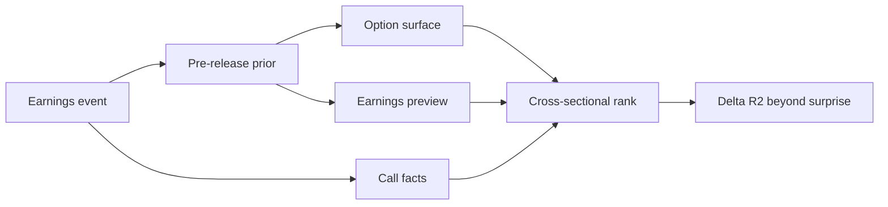

# Explaining Markets

[Explaining Markets](https://explainingmarkets.ai/) is a quarterly, out-of-sample benchmark run by Ralph S. J. Koijen and Bradford Levy (University of Chicago Booth) **in collaboration with Optiver**. The working paper is *Assessing the Benefits of Optimized Agentic AI Systems for Asset Pricing*: historical backtests leak, markets are reflexive, so the only honest test is real-time prediction against realized outcomes.

Q4 2026 scoring window: 12 Oct – 15 Dec 2026.

## The question

After an earnings release, where does this stock’s next-day market-adjusted return sit in the quarter’s cross-section — from 0 (most negative) to 1 (most positive)?

The score is **ΔR² beyond earnings surprise**. A constant 0.5 scores exactly zero. Affine remapping of predictions does not change the score: only ranking information counts. The allocator’s question is whether the agent explains anything once the surprise is already known.

## Why Optiver’s surface is the prior

Each event can carry option-implied stats measured **before** the release (liquid names only):

| Statistic | What it is |
|---|---|
| Implied earnings vol | Standard deviation of the move options price in |
| Implied absolute move | Size of the priced move (directionless) |
| 25-delta skew | Call IV minus put IV; negative means downside protection is richer |

That surface is the market’s pre-release distribution. The agent’s job is the residual: guidance vs the prior path, forward-looking call content, and divergence from what options already priced — not restating the surprise the benchmark already absorbs.

## Layout

| Path | Role |
|---|---|
| [`APPROACH.md`](APPROACH.md) | Scoring identity, signal design, production clocks |
| [`CONCEPTS.md`](CONCEPTS.md) | Glossary of terms with primary sources |
| [`agent/`](agent/) | Modal webhook receiver + `predict.py` strategy |
| [`agent/README.md`](agent/README.md) | Deploy guide (credentials, webhook URL, tests) |

## Docs

- Competition docs: https://explainingmarkets.ai/docs
- API base: `https://api.explainingmarkets.ai/v1`
- Contact: contact@explainingmarkets.ai
